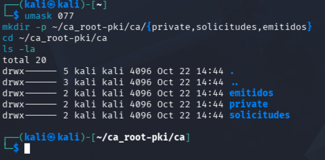
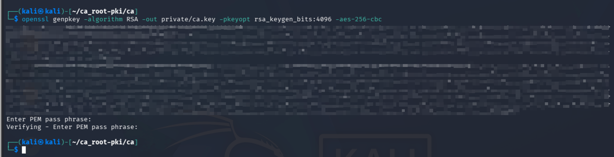
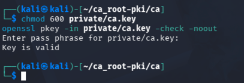
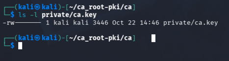
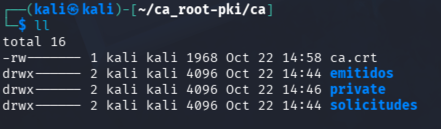
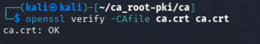
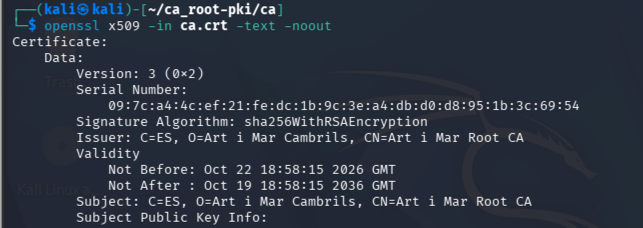

# Evidencias de Validación - Fase 2 - CA
## 1. Preparacion del directorio

```bash
umask 077
mkdir -p ~/ca_root-pki/ca/{private,solicitudes,emitidos}
cd ~/ca_root-pki/ca
ls -la
```
- Creaciión del directorio de trabajo con permisos restrictivos: `umask 077 && mkdir -p ~/ca_root-pki/ca/{private,solicitudes,emitidos}`

    

## 2. Generación de la clave privada de la CA

```bash
openssl genpkey -algorithm RSA -out private/ca.key -pkeyopt rsa_keygen_bits:4096 -aes-256-cbc
chmod 600 private/ca.key
openssl pkey -in private/ca.key -check -noout
```

- Generación de la clave privada de la CA: `openssl genpkey -algorithm RSA -out private/ca.key -pkeyopt rsa_keygen_bits:4096 -aes-256-cbc`

    

- Verificación de la clave privada: `openssl pkey -in private/ca.key -check -noout`

    

- Permisos de la clave privada de la CA: `chmod 600 private/ca.key`

   

## 3. Generación del certificado de la CA

```bash
openssl req -x509 -new \
  -sha256 \
  -days 3650 \
  -key private/ca.key \
  -out ca.crt \
  -subj "/C=ES/O=Art i Mar Cambrils/CN=Art i Mar Root CA" \
  -addext "basicConstraints=critical,CA:TRUE,pathlen:0" \
  -addext "keyUsage=critical,keyCertSign,cRLSign" \
  -addext "subjectKeyIdentifier=hash"
```
- Generación del certificado ca.crt:

  

## 4. Inspeccionar y verificar el certificado de la CA
```bash
openssl verify -CAfile ca.crt ca.crt
```


```bash
openssl x509 -in ca.crt -text -noout
```
Al ser un certificado autofirmado, la verificación de la cadena de confianza se realiza contra sí mismo, por lo que el issuer coincide con el subject.



___
## Firma
## 1. Verificación de la recepcion de la Solicitud de Firma de Certificado (CSR) del Servidor
```bash
ls -la solicitudes/
```
  

## 2. Crear el fichero de extensiones temporal (servidor.ext) para el nuevo dominio:


## 3. Firmar la Solicitud de Firma de Certificado (CSR) del Servidor con la CA
```bash
openssl x509 -req \
  -in solicitudes/servidor.csr \
  -CA ca.crt \
  -CAkey private/ca.key \
  -CAcreateserial \
  -out emitidos/servidor.crt \
  -days 365 \
  -sha256 \
  -extfile servidor.ext
```
- Firma de la CSR del Servidor con la CA:
- 

## 4. Inspeccionar y verificar el certificado del Servidor emitido por la CA
```bash
openssl verify -CAfile ca.crt emitidos/servidor.crt
```


## 5. Enviar el certificado del Servidor emitido por la CA al Servidor para su instalación
```bash
scp emitidos/servidor.crt ca.crt ${SERVER_USER}@${SERVER_ADDRESS}:~/mf0489/

```
