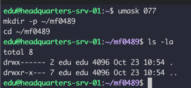
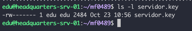
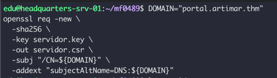
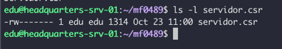

# Evidencias de Validación - Fase 2 - Servidor
## 1. Preparacion del directorio
```bash
umask 077
mkdir -p ~/mf0489
cd ~/mf0489
ls -la
```
- Creación del directorio de trabajo con permisos restrictivos: 

    

## 2. Generación de la clave privada del Servidor
```bash
openssl genpkey -algorithm RSA -out servidor.key -pkeyopt rsa_keygen_bits:3072
chmod 600 servidor.key
```
- Archivo generado: `servidor.key` con permisos restrictivos: `chmod 600 servidor.key`

    

## 3. Generación de la Solicitud de Firma de Certificado (CSR) del Servidor
```bash
DOMAIN="portal.artimar.thm"
openssl req -new \
  -sha256 \
  -key servidor.key \
  -out servidor.csr \
  -subj "/CN=${DOMAIN}" \
  -addext "subjectAltName=DNS:${DOMAIN}"
```
- Ejecución del comando para generar la CSR del Servidor:
    

- Archivo generado: `servidor.csr` con permisos restrictivos: `chmod 600 servidor.csr`

    

## 4. Inspeccionar y verificar la Solicitud de Firma de Certificado (CSR) del Servidor
```bash
openssl req -in servidor.csr -text -noout -verify
```
- Verificación de la CSR del Servidor:
    
## 5. Transferir la CSR del Servidor a la CA para su firma
```bash
scp servidor.csr ${CA_MACHINE_USER}@${CA_MACHINE_ADDRESS}:~/ca_root-pki/ca/solicitudes/
```

   

## 6. Verificación y firma de la CSR del Servidor en la CA
[Verificación y firma de la CSR del Servidor en la CA](../ca/evidencias.md#firma)

## 7. Instalación de los certificados en las rutas protegidas del Servidor


```bash
cd ~/mf0489
sudo mkdir -p /etc/ssl/mf0489
sudo install -o root -g root -m 600 servidor.key /etc/ssl/private/servidor.key
sudo install -o root -g root -m 644 servidor.crt /etc/ssl/certs/servidor.crt
sudo install -o root -g root -m 644 ca.crt /etc/ssl/mf0489/ca.crt
```


## 8. Verificación sin confiar en la CA:
```bash
openssl verify \
  -purpose sslserver \
  -verify_hostname portal.artimar.thm \
  /etc/ssl/certs/servidor.crt
  ```


El certificado es incorrecto porque no está verificado por ninguna autoridad

## 9. Verificación con confianza en la CA:
```bash
sudo openssl verify \
  -CAfile /etc/ssl/mf0489/ca.crt \
  -purpose sslserver \
  -verify_hostname portal.artimar.thm \
  /etc/ssl/certs/servidor.crt
  ```


Ejecutado precedido de `sudo`, ya que el usuario no tiene permisos para acceder a la ca.crt, "... El certificado de la CA se almacena aquí para verificaciones, pero no se incorpora automáticamente al almacén global de confianza."

## 10. Provocar fallo de identidad:
```bash
sudo openssl verify \
  -CAfile /etc/ssl/mf0489/ca.crt \
  -purpose sslserver \
  -verify_hostname portal.erroneo.thm \
  /etc/ssl/certs/servidor.crt
  ```


## 11. Verificación de fechas de validez:
```bash
openssl x509 -in /etc/ssl/certs/servidor.crt -noout -startdate -enddate
  ```


```bash
openssl x509 -in /etc/ssl/certs/servidor.crt -noout -checkend 0
```


## 12. Comprobar la correspondencia de la clave privada y el certificado:
```bash
from_private=$(sudo openssl pkey -in /etc/ssl/private/servidor.key -pubout -outform DER | openssl dgst -sha256)
from_public=$(openssl x509 -in /etc/ssl/certs/servidor.crt -pubkey -noout | openssl pkey -pubin -outform DER | openssl dgst -sha256)

if [ "$from_private" = "$from_public" ]; then
    echo "Public keys match"
else
    echo "[!] ERROR: Private key and certificate do not match."
    exit 1
fi
```


##13.  Tabla de Comprobaciones de Validación PKI

**Dominio:** `portal.artimar.thm`

| Comprobación | Resultado real | Interpretación |
|---|---|---|
| **La CA raíz se verifica con su propio certificado** | `ca.crt: OK` | La Autoridad Certificadora es raíz y actúa como su propio ancla de confianza autofirmada. |
| **Verificación sin confiar en la CA** | `error 20 at 0 depth: unable to get local issuer certificate` | El sistema rechaza el certificado del servidor al no disponer del certificado público de la CA (`ca.crt`) para validar la cadena de confianza. |
| **Certificado verificado con `-CAfile`** | `/etc/ssl/certs/servidor.crt: OK` | El certificado del servidor es validado correctamente al establecerse la cadena de confianza mediante la CA raíz proporcionada. |
| **SAN coincide con el DNS elegido** | Verificación exitosa (`OK`) para `portal.artimar.thm` | El *Subject Alternative Name* (SAN) coincide exactamente con el dominio de destino autorizado en la infraestructura. |
| **Verificación con DNS incorrecto** | Error de coincidencia de nombre (*Hostname mismatch*) | El certificado rechaza la validación al evaluar un nombre de dominio no especificado en la extensión SAN. |
| **Certificado vigente** | Fechas `notBefore`/`notAfter` válidas y `-checkend 0` superado | El certificado se encuentra dentro de su período de validez autorizado y no ha caducado. |
| **Clave privada y certificado corresponden** | Hashes SHA-256 idénticos en ambas salidas de clave pública en formato DER | Demostración criptográfica de que la clave privada y el certificado público forman un par de claves correspondiente. |