# Evidencias de Validación - Fase 3

## 1. Estado actual del servidor y servicios Docker

```
docker compose ps
docker compose ls
ss -tulnp

```

* Comprobación del estado de los contenedores activos, proyectos de Compose en ejecución y sockets de red escuchando en el host previo a la modificación de la arquitectura:

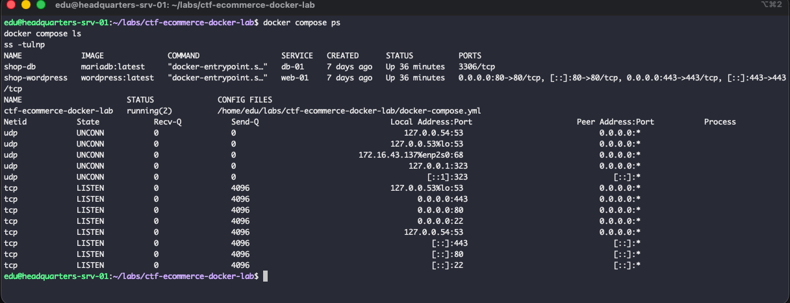

## 2. Petición de prueba desde una máquina externa (HTTP)

```
curl -I http://IP_SERVIDOR:PUERTO_ACTUAL/

```

* Verificación de la conectividad y respuesta HTTP del servicio web antes de la incorporación del Reverse Proxy:

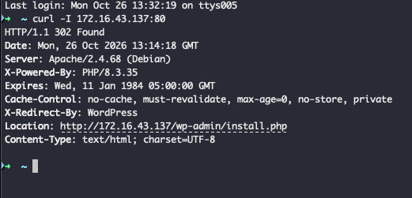'

## 3. Comprobación de certificados e infraestructura PKI

### 3.1. Inspección de permisos de las claves y certificados instalados

```
sudo ls -l /etc/ssl/private/servidor.key
ls -l /etc/ssl/certs/servidor.crt
ls -l /etc/ssl/mf0489/ca.crt

```

* Verificación de la presencia de los certificados emitidos en la Fase 2 y de la restricción de permisos en la clave privada (`600`):

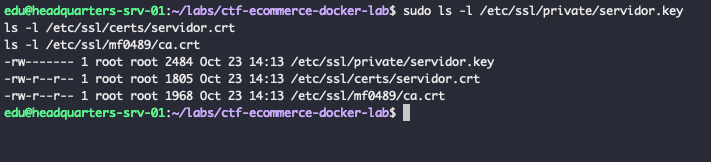

### 3.2. Verificación criptográfica del certificado del servidor frente a la CA

```
openssl verify \
  -CAfile /etc/ssl/mf0489/ca.crt \
  -purpose sslserver \
  -verify_hostname portal.artimar.thm \
  /etc/ssl/certs/servidor.crt

```

* Validación exitosa (`OK`) del certificado del servidor cotejándolo contra la Autoridad Certificadora raíz y comprobando la coincidencia del nombre de host SAN (`portal.artimar.thm`):
  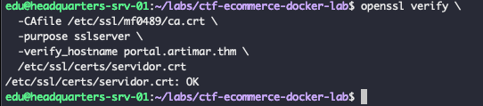

---

## Incorporación del Reverse Proxy y Docker Compose

### 1. Validación de sintaxis de la orquestación

```bash
docker compose config --quiet

```

* **Descripción:** Comprobación de la validez sintáctica del archivo `docker-compose.yml` modificado con el servicio `reverse-proxy` (Nginx), sin errores de formato ni directivas obsoletas.


### 2. Justificación Técnica de la Configuración de Docker Compose

* **¿Qué realiza `ports`?**
  Mapea y publica los puertos de la interfaz del host Ubuntu hacia los puertos internos del contenedor. En `reverse-proxy`, `"80:80"` y `"443:443"` redirigen el tráfico web entrante del exterior directamente hacia Nginx.
* **¿Para qué sirve cada entrada de `volumes` en `reverse-proxy`?**
* `./nginx/default.conf:/etc/nginx/conf.d/default.conf:ro`: Monta la configuración personalizada del proxy.
* `/etc/ssl/certs/servidor.crt:/etc/nginx/certs/servidor.crt:ro`: Suministra el certificado público X.509 del servidor.
* `/etc/ssl/private/servidor.key:/etc/nginx/certs/servidor.key:ro`: Suministra la clave privada del servidor para la negociación TLS.


* **¿Qué significa `:ro`?**
  *Read-Only* (Solo lectura). Garantiza que el contenedor no pueda alterar ni corromper los certificados ni los archivos de configuración del host.
* **¿Por qué Nginx necesita `servidor.key`, pero no `ca.key`?**
  Nginx utiliza `servidor.key` para descifrar el tráfico TLS e iniciar la sesión cifrada con los clientes. `ca.key` es la clave privada de la Autoridad Certificadora exclusiva para firmar certificados y debe permanecer aislada y fuera del servidor de producción.
* **¿Necesita el reverse proxy estar conectado directamente a la red de la base de datos?**
  No. El reverse proxy solo redirige peticiones HTTP/HTTPS al contenedor de la aplicación (`web-01`). Las consultas a la base de datos las gestiona internamente la aplicación a través de la red aislada `priv-net`.

---

## Configuración de Nginx Reverse Proxy y Plantillas Dinámicas

### 1. Creación de la plantilla de configuración dinámica

El archivo `default.conf` se genera dinámicamente a partir de la plantilla `nginx/default.conf.template`, sustituyendo la variable `${DOMAIN_NAME}` por el valor definido en el archivo `.env`.

[plantilla](../../../../../nginx/default.conf.template)


### 2. Verificación del archivo generado dinámicamente en el contenedor

```bash
docker compose exec reverse-proxy cat /etc/nginx/conf.d/default.conf
```

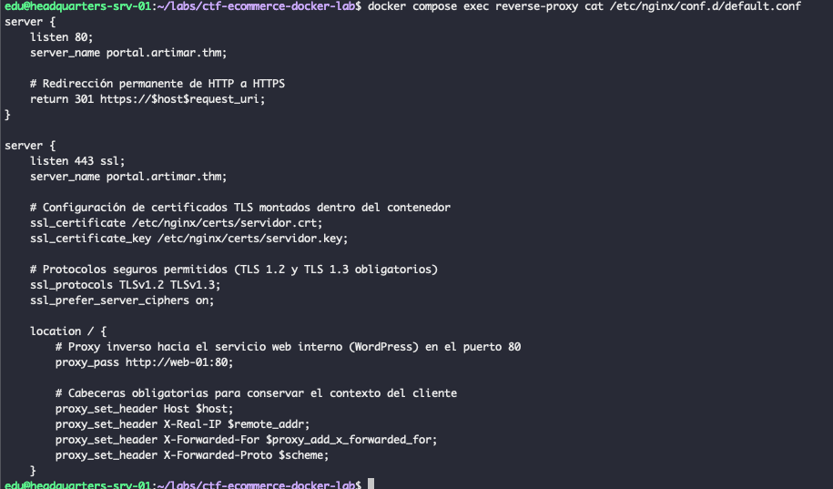

### 3. Validación sintáctica de la configuración de Nginx

```bash
docker compose exec reverse-proxy nginx -t

```

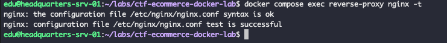

### 4. Verificación de escuchas en puertos y conectividad básica (80 y 443)

```bash
curl -I portal.artimar.thm:80
curl -Ik portal.artimar.thm:443
```

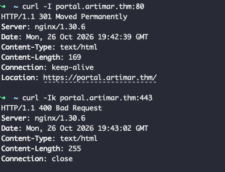


## Validación de la Aplicación y la Base de Datos

Se comprueba el correcto funcionamiento de WordPress a través del proxy inverso, validando la persistencia de los datos, la ausencia de errores y una navegación fluida bajo HTTPS sin incidencias de redirección ni fallos de comunicación con el backend.


### 1. Página de inicio de sesión (Login Page)

Acceso seguro al panel de autenticación de WordPress mediante HTTPS, confirmando que las peticiones y formularios se procesan correctamente a través del proxy perimetral de Nginx.

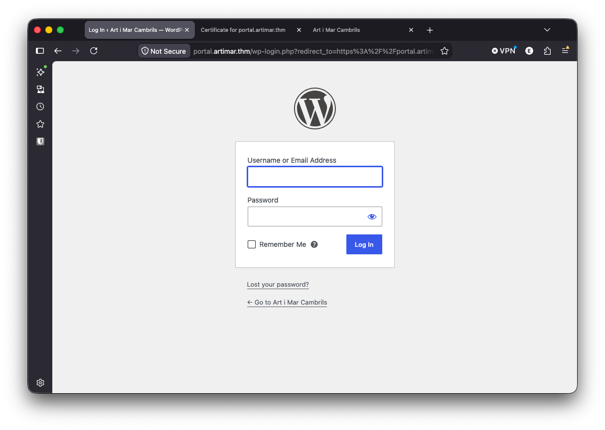

### 2. Panel de administración (Admin Dashboard)

Visualización del panel de control tras un inicio de sesión exitoso, lo que valida de forma directa la correcta comunicación con la base de datos MariaDB y la persistencia íntegra de los datos previos del entorno.

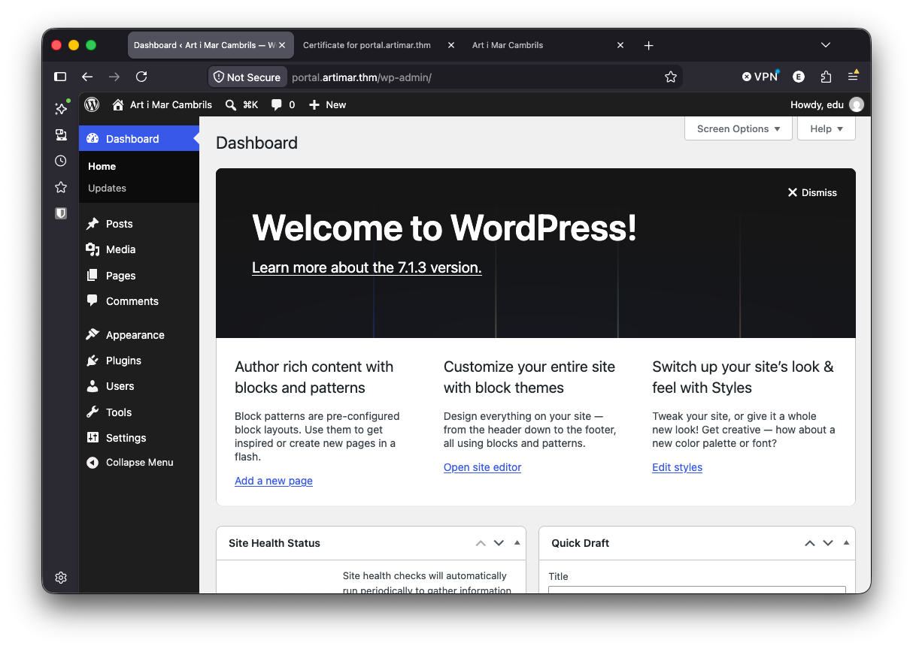

### 3. Página principal (Homepage)

Comprobación de que la página principal de la aplicación carga de manera óptima bajo el dominio seguro, sin errores de pasarela (`502 Bad Gateway`) ni problemas de contenido mixto.

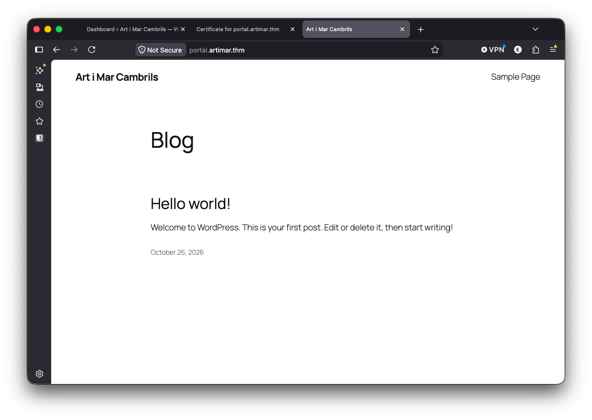

### 4. Navegación interna (Navigation to Sample Page)

Prueba de navegación a través de los enlaces internos del sitio para verificar que el reenvío de cabeceras (`X-Forwarded-Proto`) opera adecuadamente, permitiendo que la aplicación interprete el protocolo original y evite bucles de redirección.

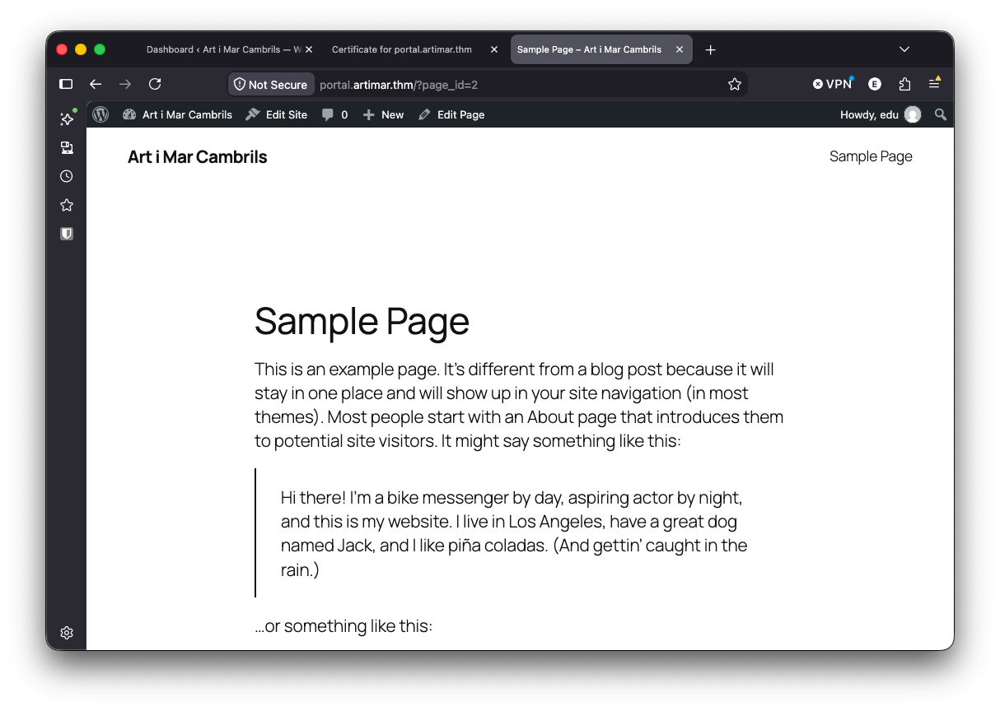

---

## Comprobación HTTPS desde un Cliente

Se realizan las pruebas de validación de seguridad de extremo a extremo desde el equipo cliente, verificando la redirección permanente y la cadena de confianza del certificado frente a la CA sin emplear parámetros inseguros[cite: 1].

### 1. Prueba de redirección HTTP → HTTPS

```bash
DOMINIO="portal.artimar.thm"
IP_SERVIDOR="IP_DE_ TU_SERVIDOR"

curl -I \
  --resolve "${DOMINIO}:80:${IP_SERVIDOR}" \
  "http://${DOMINIO}/"

```

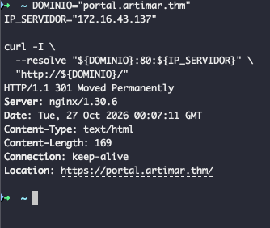

### 2. Verificación del acceso HTTPS con la CA

```bash
CA_CERT="./ca.crt"
DOMINIO="portal.artimar.thm"
IP_SERVIDOR="IP_DE_ TU_SERVIDOR"

curl -v \
  --cacert "$CA_CERT" \
  --resolve "${DOMINIO}:443:${IP_SERVIDOR}" \
  "https://${DOMINIO}/" \
  -o /dev/null

```

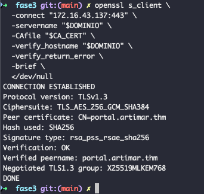

### 3. Verificación avanzada del servidor con OpenSSL

```bash
openssl s_client \
  -connect "${IP_SERVIDOR}:443" \
  -servername "$DOMINIO" \
  -CAfile "$CA_CERT" \
  -verify_hostname "$DOMINIO" \
  -verify_return_error \
  -brief \
  </dev/null

```

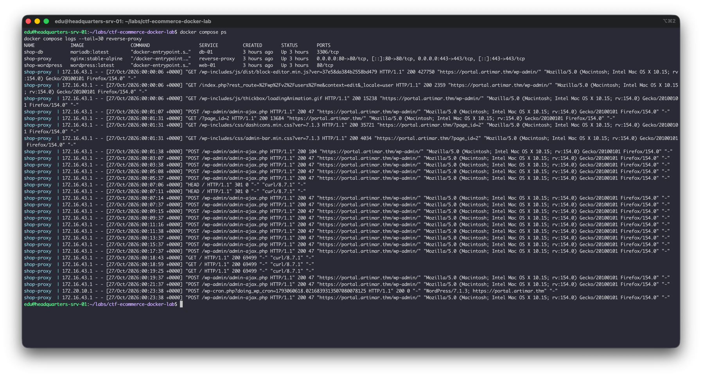

### 4. Estado de servicios y logs del proxy

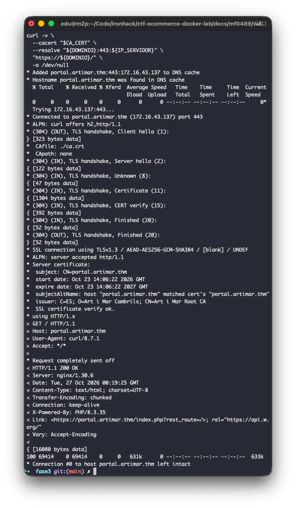
