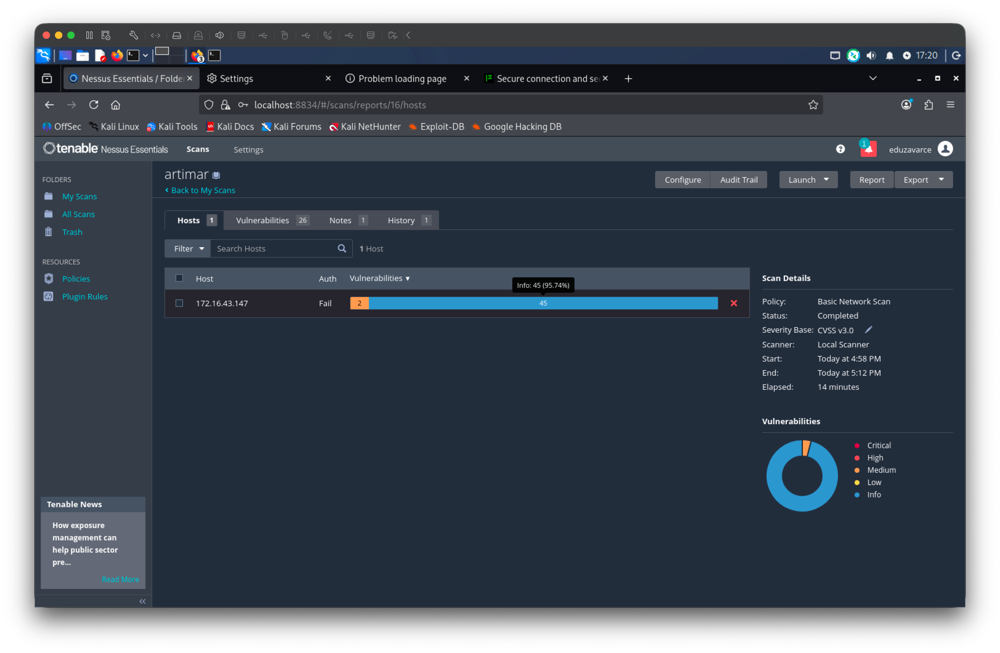
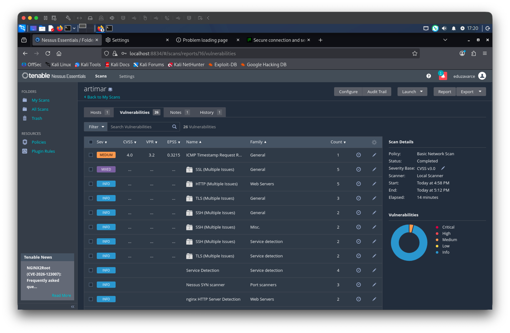
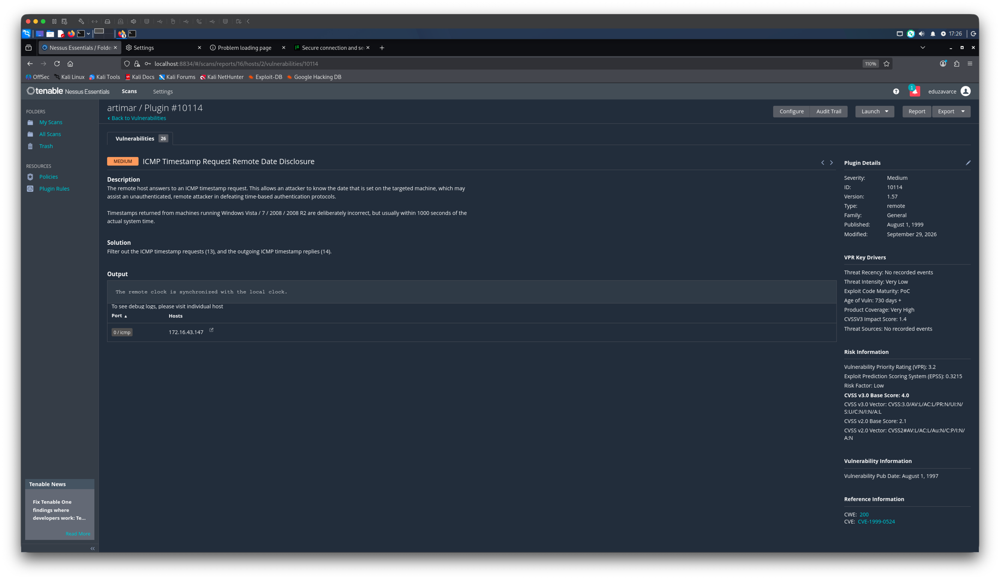
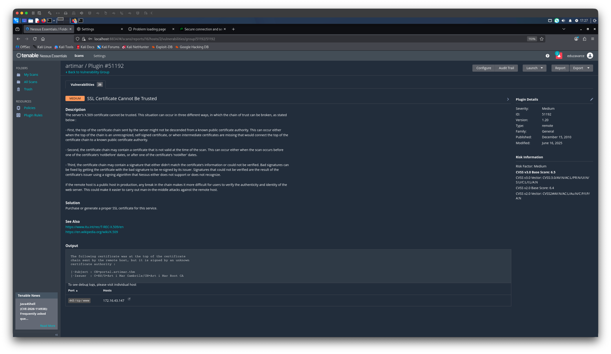
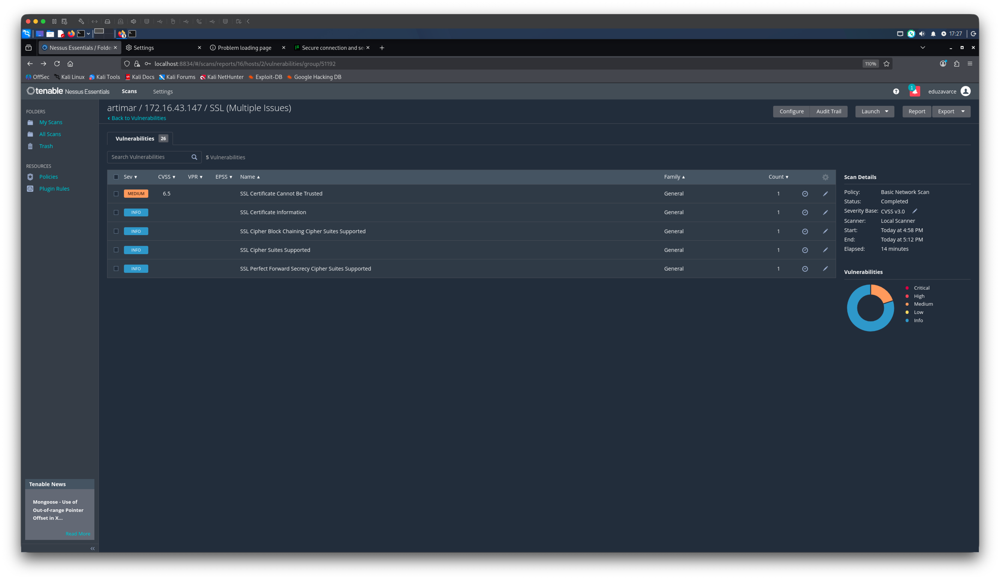

# MF0490 — Reconocimiento inicial (referencia histórica)

> Este documento conserva únicamente el reconocimiento de la instalación base. No forma parte del recorrido del reto ni contiene pasos de explotación. El recorrido validado está en `validations/fase1/` y `validations/fase2/`.

## 1. Entorno de evaluación

- **Máquina objetivo:** VM Ubuntu de Art i Mar Cambrils.
- **Cliente de evaluación:** Kali Linux.
- **Herramienta de reconocimiento:** Nessus Essentials.
- **Tipo de análisis:** Basic Network Scan.
- **Credenciales de análisis:** Nessus muestra `Auth: Fail`; no se configuraron credenciales SSH.
- **Duración observada:** 14 minutos.

### Evidencia del análisis

La captura resumen muestra un análisis completado con la política `Basic Network Scan` sobre un host (`172.16.43.147`). La comprobación autenticada aparece como fallida; el análisis de red igualmente finalizó.


## 2. Hallazgos del análisis

Nessus Essentials no permite generar informes ni exportaciones de análisis. Por ello, los hallazgos relevantes se registran manualmente y se respaldan con capturas de la interfaz.

La pestaña de vulnerabilidades muestra 26 entradas agrupadas. La vista del host indica 2 hallazgos de severidad media y 45 informativos. La captura inicial de la lista es parcial; los detalles de los dos hallazgos medios se revisaron por separado.

| Plugin ID | Hallazgo | Severidad | Puerto / servicio | CVE (si aplica) | Decisión / seguimiento |
|---|---|---|---|---|---|
| `10114` | ICMP Timestamp Request Remote Date Disclosure | Medium | `0/icmp` | `CVE-1999-0524` | Revela información temporal; no proporciona acceso ni una sesión de usuario. No es candidato para la etapa inicial. |
| `51192` | SSL Certificate Cannot Be Trusted | Medium | `443/tcp` (`www`) | No indicado | El certificado del laboratorio está firmado por Art i Mar Root CA, que Nessus no confía automáticamente. Es un hallazgo de confianza de certificado, no una vía de acceso inicial. |









## 3. Reconocimiento de servicios con Nmap

Se realizó un escaneo TCP completo desde Kali para identificar puertos accesibles y detectar las versiones anunciadas por los servicios. El resultado confirma que Nginx y OpenSSH son los únicos servicios TCP abiertos observados desde el cliente; MariaDB no aparece expuesto.

**Comando ejecutado:**

```bash
sudo nmap -Pn -n -sS -sV -p- --open -T3 --reason \
  -oN nmap-initial.txt 172.16.43.147
```

**Resultado observado:**

```text
Nmap scan report for 172.16.43.147
Host is up, received arp-response (0.00090s latency).
Not shown: 65532 closed tcp ports (reset)
PORT    STATE SERVICE  REASON         VERSION
22/tcp  open  ssh      syn-ack ttl 64 OpenSSH 10.2p1 Ubuntu 2ubuntu3.8 (Ubuntu Linux; protocol 2.0)
80/tcp  open  http     syn-ack ttl 63 nginx 1.30.6
443/tcp open  ssl/http syn-ack ttl 63 nginx 1.30.6
MAC Address: 00:0C:29:EB:53:EB (VMware)
Service Info: OS: Linux; CPE: cpe:/o:linux:linux_kernel
```

El reconocimiento de versiones por sí solo no confirma una vulnerabilidad explotable. Estas observaciones corresponden a la instalación base y no son pasos del recorrido final, documentado en las fases 1 y 2.

## 4. Reconocimiento web y WordPress desde Kali

Las comprobaciones HTTP confirmaron la redirección de HTTP a HTTPS y permitieron identificar las versiones publicadas por la aplicación:

```text
HTTP: 301 Moved Permanently → HTTPS
HTTPS: 200 OK
Server: nginx/1.30.6
X-Powered-By: PHP/8.3.36
WordPress: 7.1.5 (detectado por WhatWeb y WPScan)
```

WPScan identificó además:

- Tema activo `Twenty Twenty-Five` 1.5; no detectó plugins ni temas vulnerables.
- `xmlrpc.php` accesible, `readme.html` publicado y `wp-cron.php` aparentemente habilitado.
- No se proporcionó token de WPScan, por lo que no se incluyeron resultados de su base de vulnerabilidades. Estos indicios no demuestran por sí solos una vulnerabilidad explotable.

**Nota de reproducibilidad:** la versión detectada en esa VM (`WordPress 7.1.5`, `PHP 8.3.36`) no coincide con la etiqueta WordPress `7.1.3-php8.3-apache` anotada en `docker-compose.yml`. Este dato pertenece al reconocimiento de la instalación base y no afecta al recorrido NFS/SSH del host.

### Comprobaciones adicionales de rutas

- `/readme.html` respondió `200 OK` y publicó un archivo de 7.407 bytes.
- `/wp-json/` y `/robots.txt` respondieron `404 Not Found` con el encabezado `Apache/2.4.69 (Debian)`. Esto revela una diferencia entre rutas/respuestas del proxy y las respuestas de WordPress, además de identificar el servidor backend; no demuestra por sí mismo acceso ni una vulnerabilidad.
- La portada anuncia la API REST mediante `/?rest_route=/`; esa ruta respondió correctamente y permitió enumerar sus namespaces públicos.

La ruta alternativa `/?rest_route=/` respondió `200 OK` y expuso el nombre/URL públicos del sitio, los namespaces (`oembed/1.0`, `wp/v2`, `wp-site-health/v1`, `wp-block-editor/v1`, `wp-abilities/v1`) y las definiciones de rutas. El filtrado de la respuesta mostró rutas registradas para usuarios, entradas, medios, plugins y temas. Las comprobaciones registradas se limitaron a solicitudes GET públicas.

La solicitud GET pública a `/?rest_route=/wp/v2/users&per_page=20` devolvió un registro: ID `1`, nombre visible `admin` y slug `admin`. Esto confirma enumeración pública de un usuario, pero no expone credenciales ni concede acceso. Se registra como divulgación de información; no se intentó autenticación ni fuerza bruta.

La solicitud GET pública a `/?rest_route=/wp/v2/posts&per_page=10` devolvió una entrada: ID `1`, slug `hello-world`, título `Hello world!`, autor ID `1`. Es el contenido de ejemplo de WordPress y confirma que la API también publica contenido y su ID de autor; no revela una vulnerabilidad de ejecución ni acceso al host.

### Búsqueda local en Exploit-DB (SearchSploit)

Se consultó la base local de SearchSploit con los términos `wordpress 7.1.5` y `wordpress 7.1`. La búsqueda exacta devolvió resultados de tres plugins (NEX-Forms, DZS Videogallery y Rest Google Maps); la búsqueda amplia también devolvió resultados antiguos de WordPress Core y varios plugins/temas. No apareció un exploit aplicable al núcleo WordPress 7.1.5 en la salida compartida.

WPScan no detectó plugins instalados y el tema identificado es Twenty Twenty-Five 1.5, por lo que los resultados que dependen de otros plugins/temas no son candidatos para este objetivo. La salida local de SearchSploit tampoco demuestra que la base esté actualizada ni sustituye la verificación de avisos oficiales. **Conclusión:** no se selecciona un exploit de WordPress con la evidencia disponible.

### Enumeración de contenido con Gobuster

Se realizó enumeración HTTPS con Gobuster 3.8.2 y la wordlist `dirb/common.txt`, incluyendo extensiones `php`, `txt` y `bak`:

```bash
gobuster dir -u https://172.16.43.147/ \
  -w /usr/share/wordlists/dirb/common.txt \
  -x php,txt,bak -k -t 10 \
  -o gobuster-https.txt
```

Hallazgos destacables: `license.txt` (`200`), `wp-login.php` (`200`), `xmlrpc.php` (`405`), `server-status` y archivos `.ht*` (`403`). Los PHP internos detectados con `200` y tamaño cero (`wp-config.php`, `wp-load.php`, `wp-cron.php`, entre otros) no indican por sí mismos que su código o secretos sean descargables; las respuestas se deben interpretar como respuestas HTTP de ejecución PHP. `wp-settings.php` devolvió `500`, sin que se atribuyera ese código a una vulnerabilidad.

Las comprobaciones posteriores corrigieron la observación inicial de Gobuster: `/wp-admin/` responde `302` y redirige a `https://172.16.43.147/wp-login.php` (se conserva HTTPS); `/wp-content/` responde `200 OK` con cuerpo GET vacío en la salida observada; `/wp-includes/` responde `403 Forbidden`. No se observó un listado de directorio ni se confirmó una redirección de autenticación a HTTP. El cuerpo vacío de `/wp-content/` no constituye por sí mismo una vulnerabilidad.

### Enumeración ampliada de temas y plugins con WPScan

WPScan 3.8.28 se ejecutó desde Kali con `--enumerate ap,at`. La salida reportó **ningún plugin encontrado** mediante sus métodos pasivos. Identificó el tema activo `Twenty Twenty-Five` 1.5 y ubicaciones conocidas para `Twenty Twenty-Four` 1.6 y `Twenty Twenty-Three` 1.7; las dos últimas devolvieron `403` en las comprobaciones de ubicación. La búsqueda de temas completó 33.977 comprobaciones. No se proporcionó API token, por lo que no se generaron coincidencias con la base de vulnerabilidades.

Esta salida no confirma que las versiones de tema sean vulnerables ni que existan plugins ocultos: la enumeración de plugins fue pasiva. Como el core reportado está actualizado y no se observan plugins vulnerables, no se justifica seguir con un escaneo agresivo de decenas de miles de rutas sin una hipótesis concreta.

## 5. Alcance UDP del reconocimiento histórico

### Reconocimiento UDP

Desde Kali se revisaron los 100 puertos UDP más comunes:

```bash
sudo nmap -Pn -n -sU --top-ports 100 --open -T3 --reason 172.16.43.147
```

El escaneo no confirmó puertos UDP abiertos. Nmap reportó 60 puertos cerrados (`port-unreach`) y 40 como `open|filtered` (sin respuesta); estos últimos son inconclusos, no prueba de que estén abiertos ni cerrados. No se identificó un servicio UDP candidato.

La enumeración de la instalación web y de los servicios TCP/UDP no identificó una vulnerabilidad que proporcionara acceso al host. La ruta final no utiliza WordPress, Nessus ni Metasploit: el acceso inicial validado es la vulnerabilidad de configuración NFS documentada en la Fase 1; la escalada local se documenta en la Fase 2.

## 6. Nota sobre exportación de Nessus Essentials

En el análisis registrado no se generó informe exportable desde Nessus Essentials; los hallazgos se transcribieron manualmente y se respaldan con las capturas disponibles.
