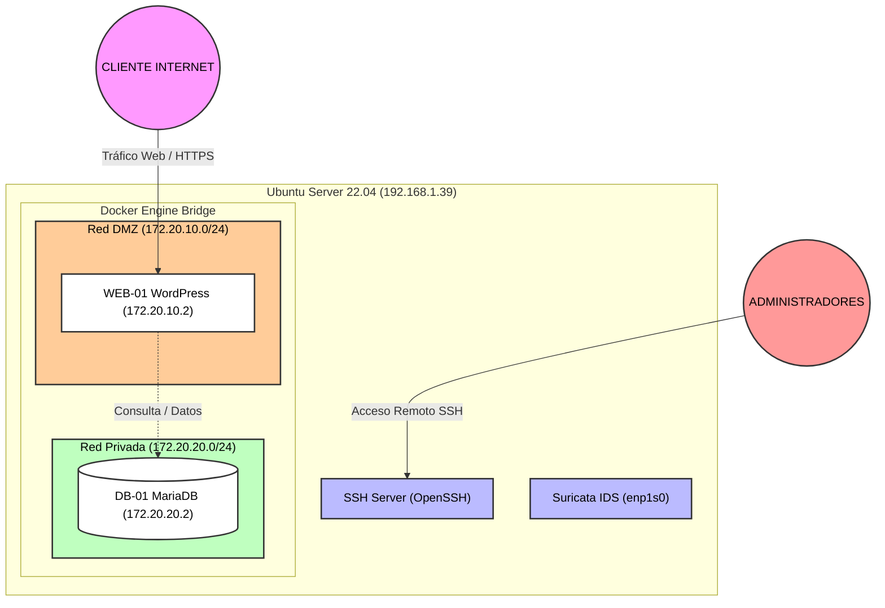
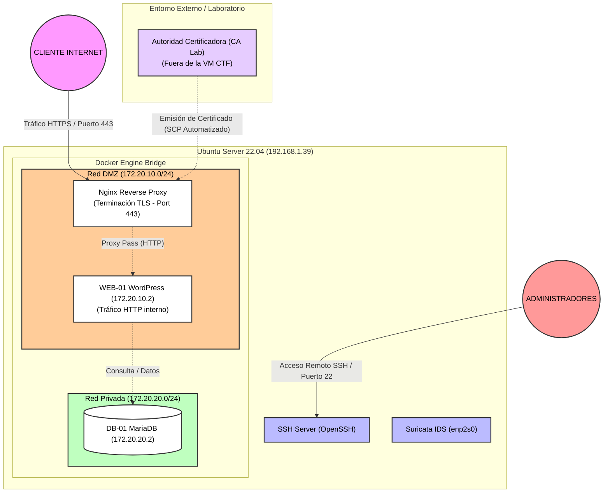
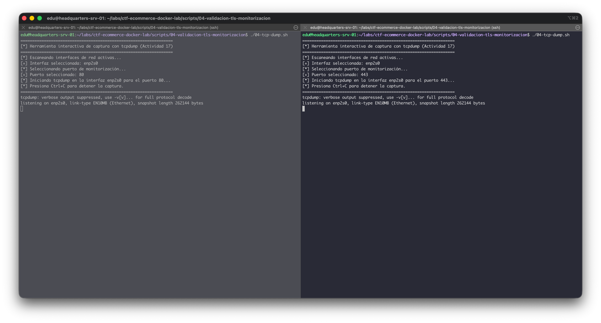
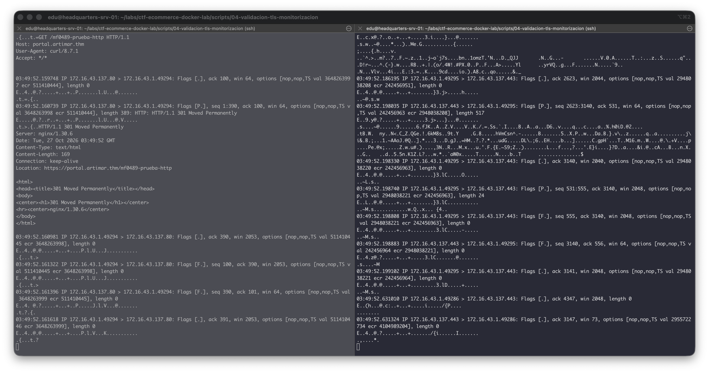

# *Art i Mar Cambrils*

- **Nombre del proyecto:** Despliegue Seguro de E-commerce con Contenedores y Redes Segmentadas *Art i Mar Cambrils*
- **Integrantes:** Eduardo Zavarce Forsythe
- **Temática:** Despliegue de comercio electrónico local de artesanía marinera, decoración y cerámica con WordPress y MySQL sobre una arquitectura de red segmentada.

---
## MF0488 — Servidor, Monitorización e Infraestructura Docker

<details>
<summary>Detalles MF0488 </summary>

### 1. Guía de Instalación y Despliegue

#### Prerequisitos: 
- Servidor Ubuntu 22.04.5 LTS.

Para replicar y desplegar la infraestructura sobre un servidor base con Ubuntu 22.04.5 LTS, ejecute los siguientes pasos secuenciales desde la raíz del repositorio:

1. **Ejecutar los scripts de preparación del entorno e instalación:**
    ```bash
    ./scripts/00-initial-setup/00-create-folders.sh
    ./scripts/00-initial-setup/01-install-docker.sh
    ./scripts/00-initial-setup/02-install-dependencies.sh
    ```

2. **Configurar las variables de entorno:**
    
    Genere su archivo de configuración .env utilizando como base la plantilla proporcionada (template.env):

    ```bash
    cp template.env .env
    ```
    (Modifique los parámetros y credenciales dentro de .env según sea necesario para su entorno).

3. **Desplegar los contenedores:**

    Inicie la orquestación de servicios en segundo plano mediante Docker Compose:

    ```bash
    docker compose up -d
    ```

4. **Configuracion de monitorización:**

    ```bash
    ./scripts/01-suricata/00-install.sh
    ./scripts/01-suricata/01-config.sh
    ```
---

### 2. Descripción breve del sistema
La infraestructura representa un servidor virtual corporativo expuesto a internet simulando el entorno de producción de una tienda artesanal local. El servicio presta una plataforma web de comercio electrónico accesible públicamente para clientes y administración. Gestiona información ficticia de catálogo de productos artesanales, altas de usuarios, pedidos y transacciones comerciales simuladas. La aplicación web (WordPress) funciona como interfaz de cara al cliente y pasarela de gestión del negocio, operando de forma aislada de los datos críticos para garantizar la resiliencia y la seguridad de la información.

---

### 3. Tecnologías y Componentes Previstos

| Componente                 | Tecnología                | Función                                                                                            |
| :------------------------- | :------------------------ | :------------------------------------------------------------------------------------------------- |
| **Sistema principal**      | Ubuntu 22.04.5 LTS | Sistema operativo base para la administración y alojamiento de la infraestructura.                 |
| **Acceso remoto**          | OpenSSH Server            | Administración segura y remota del servidor host mediante consola cifrada.                         |
| **Ejecución de servicios** | Docker & Docker Compose   | Orquestación y aislamiento de los servicios mediante contenedores.                                 |
| **Servicio principal (WEB-01)**     | WordPress                 | Aplicación web de comercio electrónico (tienda en línea de artesanía).                             |
| **Persistencia (DB-01)**           | MariaDB                   | Sistema de gestión de bases de datos relacionales para el almacenamiento de contenidos y usuarios. |
| **Monitorización / IDS**   | Suricata                  | Sistema de detección de intrusiones en red para la supervisión del tráfico y alerta temprana.      |

---

### 4. Arquitectura inicial



### 5. Configuración de Red y Puertos

Para garantizar la seguridad y la segmentación del tráfico, los puertos se han configurado minimizando la exposición pública de los servicios internos:

| Servicio / Componente | Puerto Expuesto (Host/VM) | Puerto en Contenedor | ¿Expuesto al exterior? | Función |
| :--- | :--- | :--- | :--- | :--- |
| **OpenSSH Server** | `22` | `22` | **Sí** | Administración remota segura del servidor host. |
| **WordPress (Web)** | `80` (HTTP) / `443` (HTTPS) | `80` / `443` | **Sí** | Acceso público de los clientes al e-commerce (*DMZ*). |
| **MariaDB (Base de datos)** | Ninguno | `3306` | **No** | Uso interno exclusivo para la persistencia de datos (*Red Privada aislada*). |

[Screenshots comprobación de configuraciones](docs/mf0488/validations/fase2/evidencias.md)

### 6. Mapa de Evidencias 

| Acción / Evento | Activo / Origen | Ubicación del Registro (Ruta / Servicio) | Datos Clave a Identificar |
| :--- | :--- | :--- | :--- |
| **Login SSH (Correcto / Incorrecto)** | Linux (Host) | `/var/log/auth.log` (o `journalctl -u ssh`) | Fecha/hora, IP de origen, Usuario, Resultado (Accepted / Failed). |
| **Petición HTTP (Correcta / Errónea)** | Web (`WEB-01`) / WordPress | Logs del contenedor Docker (`shop-wordpress`) | IP de origen, Hora, Método HTTP, URL, Código de Estado (200, 404...). |
| ** Contenedores** | Docker Engine | `/var/lib/docker/containers/` o `docker logs` | Timestamp, ID del contenedor, Mensajes de error o arranque. |

#### Evidencias:
[Screenshots de los logs](docs/mf0488/validations/fase3/evidencias.md)

---

### 7. Monitorización / IDS 

#### Suricata:

Elegido el IDS suricata para monitorear y generar alertas de actividad en la subred.

Agregada una regla para alertar peticiones de ICMP (ping).

[Configuración y pruebas](docs/mf0488/validations/fase4/evidencias.md)

---

### 8. Pruebas realizadas al entorno

| Acción | Fuente Principal de Registro | Detectada / Registrada | Información Obtenida (Detalles Clave) |
| --- | --- | --- | --- |
| **SSH correcto** | `/var/log/auth.log` | **Sí** | Fecha/hora, IP de origen, usuario autenticado, método de acceso (Accepted publickey/password). |
| **SSH incorrecto** | `/var/log/auth.log` | **Sí** | Fecha/hora, IP de origen, usuario intentado, fallo de autenticación (Failed password). |
| **Web válida** | Logs de contenedores Docker / WordPress | **Sí** | IP de origen, timestamp, método HTTP (`GET`), recurso solicitado (`/`), código de estado `200 OK`. |
| **Web 404** | Logs de contenedores Docker / WordPress | **Sí** | IP de origen, timestamp, recurso no existente solicitado, código de estado `404 Not Found`. |
| **Docker** | `docker logs` / Motor Docker | **Sí** | Timestamps de arranque, estado de los contenedores (`shop-wordpress`, `shop-mariadb`), mensajes de conectividad interna. |
| **Ping** | Suricata (`/var/log/suricata/fast.log`) | **Sí** | Alerta generada por regla propia (`sid:1000001`), IP origen del escaneo/ping, IP destino (`192.168.1.39`), protocolo ICMP. |
| **Nmap** | Suricata / Logs del sistema / Web logs | **Sí** | Identificación de barrido de puertos, peticiones múltiples concurrentes, registro de conexiones entrantes a servicios expuestos. |

[Screenshot de resultados](docs/mf0488/validations/fase5/evidencias.md)

---

</details>

## MF0489 — Fase 2: Autoridad Certificadora (CA) y Certificados TLS
<details>
<summary>Detalles MF0489</summary>

## 1. Arquitectura actualizada



### 2. Configuración de Dominio y DNS del Proyecto

* **Nombre FQDN Seleccionado:** `portal.artimar.thm`
* **Justificación del TLD (`.thm`):**
  Aunque el estándar de la IETF (RFC 2606) reserva el sufijo `.test` para entornos de pruebas locales, se ha adoptado deliberadamente el TLD no estándar **`.thm`**. Esta decisión responde a que la arquitectura de este proyecto y la máquina virtual resultante han sido diseñadas para ser exportadas y desplegadas como un escenario de laboratorio CTF en la plataforma **TryHackMe**, la cual utiliza por convención este dominio de nivel superior en sus entornos de simulación.
* **Consistencia de Identidad:** El FQDN `portal.artimar.thm` se utiliza de forma estricta y uniforme en:
   - El *Common Name* (CN) y la extensión *Subject Alternative Name* (SAN) de la CSR del servidor.
   - El archivo de extensiones `servidor.ext` utilizado durante la firma por la CA.
   - El certificado X.509 final emitido (`servidor.crt`).
   - Las validaciones criptográficas de hostname mediante OpenSSL (`-verify_hostname portal.artimar.thm`).

### 3. Guía de Automatización y Despliegue PKI (Fase 2)

El despliegue y ciclo de vida de la infraestructura de clave pública (PKI) se gestiona de forma modular a través de scripts dedicados ubicados en `scripts/02-pki/`, apoyados por un sistema centralizado de carga de variables de entorno (`load-env-variables.sh`).

#### Requisito previo: Configuración de Entorno
Asegúrese de configurar sus parámetros de red y dominio en el archivo de entorno antes de ejecutar los scripts:
```bash
cp template.env .env
```
*(Edite `.env` para ajustar `DOMAIN_NAME`, `CA_MACHINE_ADDRESS`, `CA_MACHINE_USER`, `SERVER_ADDRESS` y `SERVER_USER`).*

#### Secuencia de Ejecución del Workflow PKI:

1. **Inicialización de la Autoridad Certificadora (Entorno CA):**
   Crea la estructura de directorios con máscara segura (`umask 077`), genera la clave privada de la CA cifrada con AES-256 y emite el certificado raíz autofirmado (`ca.crt`):
   ```bash
   ./scripts/02-pki/00-ca-setup.sh
   ```

2. **Generación y Envío Automático de la CSR (Entorno Servidor):**
   Genera la clave privada del servidor (RSA 3072) y la Solicitud de Firma de Certificado (CSR) incorporando el *Subject Alternative Name* (SAN) obligatorio para el dominio, enviándola automáticamente por `scp` a la máquina CA:
   ```bash
   ./scripts/02-pki/01-server-cert.sh
   ```

3. **Firma y Retorno Automático de Certificados (Entorno CA):**
   Procesar la CSR recibida en la CA, valida las restricciones de extensión para servidores web (`serverAuth` y SAN) y devuelve automáticamente de vuelta mediante `scp` el certificado firmado (`servidor.crt`) y el certificado raíz (`ca.crt`) al servidor:
   ```bash
   ./scripts/02-pki/02-ca-sign-cert.sh
   ```

4. **Instalación y Validación Criptográfica Definitiva (Entorno Servidor):**
   Instala los certificados en las rutas protegidas del sistema operativo (`/etc/ssl/certs/`, `/etc/ssl/private/`), establece los permisos estrictos (`600`/`644`), verifica la cadena de confianza con OpenSSL (comprobando éxito y fallos por *hostname mismatch*) y valida las correspondencias de hash de las claves públicas antes de limpiar los temporales:
   ```bash
   ./scripts/02-pki/03-server-install.sh
   ```

---

### 4. Especificaciones Técnicas y de Seguridad

* **Terminación TLS:** Realizada en el borde perimetral (Nginx Reverse Proxy) para el puerto `443` (HTTPS).
* **Aislamiento de la CA:** La clave privada de la Autoridad Certificadora (`ca.key`) permanece aislada en el Entorno CA y nunca es expuesta en la red pública.
* **Permisos y Umask:** Todos los scripts aplican restricciones estrictas de privilegios (`umask 077`) para garantizar que las claves privadas de servidor y CA sean inaccesibles para usuarios no autorizados.

### 5. Evidencias y capturas de pantalla

- [Evidencias de la Autoridad Certificadora (CA)](docs/mf0489/validations/fase2/ca/evidencias.md)
- [Evidencias del Servidor](docs/mf0489/validations/fase2/server/evidencias.md)

## Implementación de HTTPS con Nginx Reverse Proxy y Docker

### 1. Decisiones de Arquitectura y Adaptación de Componentes 

Para pasar del modelo inicial expuesto en HTTP a una arquitectura segura con HTTPS de extremo a extremo, se incorporan las siguientes modificaciones fundamentales en la infraestructura de contenedores:

1. **Contenedor Reverse Proxy Perimetral (`reverse-proxy`):**
   - **Tecnología:** Se incorpora una imagen liviana oficial `nginx:stable-alpine` (`container_name: shop-proxy`).
   - **Función:** Actúa como único punto de entrada perimetral expuesto al exterior para recibir peticiones en los puertos `80` (HTTP) y `443` (HTTPS).
   - **Terminación TLS:** Realiza la negociación segura de la sesión TLS finalizando la contraseña/cifrado en la frontera perimetral.
   - **Archivos y Certificados:** Monta en modo solo lectura (`:ro`) los certificados emitiéndose en la Fase 2 instalados en `/etc/ssl/certs/servidor.crt` y `/etc/ssl/private/servidor.key`.

2. **Contenedor Web Backend (`web-01`):**
   - **Comunicación Interna:** La aplicación WordPress deja de publicar puertos directos (`80:80` / `443:443`) hacia la interfaz de la máquina virtual/host. 
   - **Protocolo Interno:** La aplicación recibe las peticiones procedentes de Nginx a través del protocolo **HTTP interno en el puerto 80 del contenedor**.
   - **Redes:** Permanece conectada a `dmz-net` para ser alcanzable por el proxy y a `priv-net` para comunicarse con la base de datos.

3. **Contenedor de Persistencia (`db-01`):**
   - **Aislamiento Estricto:** La base de datos MariaDB (`shop-db`) se mantiene aislada exclusivamente en la red privada `priv-net`.
   - **Ausencia de Proxying:** No se conecta a la red `dmz-net` ni tiene comunicación directa con Nginx, garantizando que los datos de la tienda permanezcan inaccesibles desde el exterior.

---

### 2. Segmentación de Redes y Matriz de Puertos Definitiva

| Servicio / Contenedor | Puerto Expuesto (Host/VM) | Puerto en Contenedor | Redes Docker Asociadas | ¿Expuesto al Exterior? | Función |
| :--- | :--- | :--- | :--- | :--- | :--- |
| **Nginx (`shop-proxy`)** | `80` / `443` | `80` / `443` | `dmz-net` | **Sí** | Reverse Proxy perimetral, redirección HTTP→HTTPS y terminación TLS. |
| **WordPress (`shop-wordpress`)** | Ninguno | `80` (HTTP) | `dmz-net`, `priv-net` | **No** | Aplicación e-commerce accesible únicamente mediante proxy interno. |
| **MariaDB (`shop-db`)** | Ninguno | `3306` (TCP) | `priv-net` | **No** | Persistencia de datos con acceso exclusivo para WordPress. |

---

### 3. Evidencias de Validación (Fase 3)

- [Comprobaciones Previas de Inicio y Certificados ](docs/mf0489/validations/fase3/server/evidencias.md)

---
## Implementación de HTTPS con Nginx Reverse Proxy y Docker (Fase 3)

### 1. Arquitectura final y punto de terminación TLS
La arquitectura final introduce un proxy inverso perimetral (`shop-proxy`) basado en Nginx que centraliza todo el tráfico web externo. El punto de terminación TLS se establece exclusivamente en este proxy perimetral para el puerto `443` (HTTPS), utilizando los certificados emitidos por la PKI de la Fase 2. El tráfico interno entre el proxy y el contenedor de la aplicación web (`web-01`) se canaliza mediante HTTP interno a través de una red Docker aislada (`dmz-net`), mientras que la base de datos permanece protegida en la red privada `priv-net`.

### 2. Servicios, redes y puertos antes y después de la modificación
* **Estado previo (Fase 2):** WordPress exponía directamente sus puertos HTTP al host sin cifrado perimetral ni terminación TLS.
* **Estado definitivo (Fase 3):**
   - Nginx (`shop-proxy`) expone perimetralmente los puertos `80` (HTTP) y `443` (HTTPS) en la interfaz del host.
   - El backend de WordPress (`shop-wordpress`) y MariaDB (`shop-db`) **no publican ningún puerto hacia el exterior** (`ports: []`), operando de manera exclusiva mediante redes internas de Docker.

#### Matriz de Puertos Definitiva
| Servicio / Contenedor | Puerto Expuesto (Host/VM) | Puerto en Contenedor | Redes Docker Asociadas | ¿Expuesto al Exterior? | Función |
| :--- | :--- | :--- | :--- | :--- | :--- |
| **Nginx (`shop-proxy`)** | `80` / `443` | `80` / `443` | `dmz-net` | **Sí** | Reverse Proxy perimetral, redirección HTTP→HTTPS y terminación TLS. |
| **WordPress (`shop-wordpress`)** | Ninguno | `80` (HTTP) | `dmz-net`, `priv-net` | **No** | Aplicación e-commerce accesible únicamente mediante proxy interno. |
| **MariaDB (`shop-db`)** | Ninguno | `3306` (TCP) | `priv-net` | **No** | Persistencia de datos con acceso exclusivo para WordPress. |

### 3. Decisiones tomadas en Docker Compose y Nginx
* **Docker Compose:** Se incorporó el servicio `reverse-proxy` utilizando una imagen ligera `nginx:stable-alpine`. Se mapearon únicamente los puertos `80` y `443`, y se montaron los certificados institucionales en modo de solo lectura (`:ro`).
* **Nginx:** Se implementó una plantilla dinámica (`nginx/default.conf.template`) procesada mediante variables de entorno para configurar un bloque `server` en el puerto `80` con redirección permanente (`301`) hacia HTTPS, y un bloque `server` en el puerto `443` con protocolos seguros obligatorios (`TLSv1.2` y `TLSv1.3`), inyectando las cabeceras de reenvío necesarias (`X-Forwarded-Proto`, `Host`, etc.) para la correcta interoperabilidad con WordPress.

### 4. Rutas de los certificados y permisos aplicados
Los certificados institucionales generados en la PKI se encuentran instalados en las rutas protegidas del sistema operativo host y montados de forma segura en el contenedor perimetral:
* **Certificado Público del Servidor:** `/etc/ssl/certs/servidor.crt` (Permisos: `644`)
* **Clave Privada del Servidor:** `/etc/ssl/private/servidor.key` (Permisos strictly: `600`)
* **Certificado Raíz de la CA:** `/etc/ssl/mf0489/ca.crt` (Permisos: `644`)

*(Nota: Las claves privadas se mantienen estrictamente protegidas con restricciones de `umask 077` y no se exponen en repositorios públicos).*

### 5. Cómo resolviste el nombre DNS en el cliente de laboratorio
Para permitir que las herramientas del cliente validasen correctamente el dominio con el SAN configurado (`portal.artimar.thm`) sin requerir un servidor DNS dedicado en la red de pruebas, se empleó el parámetro `--resolve` en las peticiones `curl` o, alternativamente, la configuración del archivo local `/etc/hosts` en el equipo cliente relacionando el FQDN con la IP del servidor Ubuntu (`192.168.1.39`).

### 6. Pruebas de HTTP → HTTPS y de confianza TLS
Se validó con éxito la redirección automática del tráfico plano del puerto `80` a HTTPS mediante códigos de estado `301 Moved Permanently`. Asimismo, se comprobó la cadena de confianza completa del certificado del servidor frente al certificado raíz de la CA (`ca.crt`) utilizando `curl --cacert` y verificaciones avanzadas con `openssl s_client` sin relajar la seguridad ni emplear flags inseguros (`--insecure`).

### 7. Pruebas de funcionamiento de la aplicación y de persistencia de datos
Se realizaron comprobaciones funcionales de extremo a extremo verificando la carga correcta de la página principal de la tienda, la navegación por enlaces internos, el acceso al panel de administración (login) y la correcta persistencia de la base de datos MariaDB tras los reinicios y despliegues limpios de la orquestación.

### 8. Incidencias reales encontradas y solución aplicada
* **Incidencia:** Errores de sintaxis y conflictos al inicializar Nginx con volúmenes dinámicos.
* **Solución:** Implementación de un sistema de plantillas estandarizado (`default.conf.template`) combinado con la correcta validación previa mediante `nginx -t` dentro del contenedor antes de abrir el tráfico productivo.

### 9. Instrucciones de despliegue y verificación reproducibles
Para desplegar y verificar la Fase 3 de forma automatizada, utilice los scripts dedicados proporcionados en el repositorio:
1. **Ejecutar las validaciones automatizadas desde el servidor:**
    ```bash
    ./scripts/03-nginx/00-00-server-validations.sh
    ```
2. **Ejecutar las validaciones automatizadas desde el cliente/host:**
    ```bash
    ./scripts/03-nginx/01-01-client-validations.sh
    ```

[Ver galería completa de evidencias y capturas (Fase 3)](docs/mf0489/validations/fase3/server/evidencias.md)

## Validación de seguridad, TLS y monitorización (Fase 4)

### Guía de Automatización y Ejecución de Scripts (Validación y Monitorización TLS)

Para verificar y automatizar las comprobaciones de estado, auditoría de protocolos, captura de tráfico y correlación de Suricata con Nginx correspondientes a la **Fase 4**, ejecute de forma secuencial los scripts ubicados en `scripts/04-validacion-tls-monitorizacion/`:

1. **Comprobación de estado general del entorno:**
   ```bash
   ./scripts/04-validacion-tls-monitorizacion/00-status-check.sh
   ```
2. **Auditoría de protocolos TLS y verificación de cifrado (Actividad 16):**
   ```bash
   ./scripts/04-validacion-tls-monitorizacion/01-tls-auditoria-ajustes.sh
   ```
3. **Verificación y diagnóstico de logs del sistema y contenedores:**
   ```bash
   ./scripts/04-validacion-tls-monitorizacion/03-logs-check.sh
   ```
4. **Captura interactiva de paquetes con tcpdump (Actividad 17):**
   ```bash
   ./scripts/04-validacion-tls-monitorizacion/04-tcp-dump.sh
   ```
5. **Ejecución de pruebas de conectividad desde el host/cliente:**
   ```bash
   ./scripts/04-validacion-tls-monitorizacion/05-from-host.sh
   ```
6. **Actualización y configuración automatizada de Suricata (Actividad 18):**
   ```bash
   sudo ./scripts/04-validacion-tls-monitorizacion/06-suricata-update.sh
   ```
7. **Aplicación de plantillas Nginx con formato de log TLS y pruebas de correlación:**
   ```bash
   ./scripts/04-validacion-tls-monitorizacion/07-update-nginx-logs.sh
   ```

---

### Comprobacion del estado actual

##  - Establecimiento de una línea base de HTTPS | Entorno B

### Tabla de Resultados — Validación de la Infraestructura TLS

```bash
./scripts/04-validacion-tls-monitorizacion/00-status-check.sh
```

| Prueba | Resultado real | Evidencia |
|---|---|---|
| **Contenedores y reverse proxy activos** | Correcto (`shop-db`, `shop-proxy` y `shop-wordpress` operativos) | Salida de `docker compose ps` (Servicios activos en puertos 80 y 443) |
| **Puerto 443 accesible desde el cliente** | Abierto y a la escucha en `0.0.0.0:443` y `[::]:443` | Comprobación de sockets activos mediante `ss` (`docker-proxy` en puerto 443) |
| **Certificado y dominio válidos** | Válido (`CN=portal.artimar.thm`, emitido por *Art i Mar Root CA*) | Verificación de SAN y coincidencia de hostname exitosa |
| **Verificación de confianza satisfactoria** | `Verification: OK` (Validado correctamente frente a la CA sin flags inseguros) | Salida de `curl --cacert` y `openssl s_client` completadas sin errores de confianza |
| **Versión TLS negociada** | **TLSv1.3** | Negociación segura establecida mediante OpenSSL y `curl` |
| **Cipher suite negociada** | **`TLS_AES_256_GCM_SHA384`** | Algoritmo cifrado de alto rendimiento y seguridad validado |
| **Aplicación funcionando** | Código de estado HTTP **200 OK** devuelto por WordPress con PHP/8.3.35 | Petición GET exitosa a `https://portal.artimar.thm/` |

##  - Auditoría y ajuste de TLS

### 1. Tabla de comprobación de protocolos

| Protocolo | Resultado real | ¿Cumple el requisito? |
|---|---|---|
| TLS 1.1 | Rechazado (`no protocols available`) | Sí (Deshabilitado correctamente) |
| TLS 1.2 | Conexión establecida con éxito (`Protocol version: TLSv1.2`) | Sí |
| TLS 1.3 | Conexión establecida con éxito (`Protocol version: TLSv1.3`) | Sí |

---

### 2. Valoración de los algoritmos negociados 

1. **¿Qué versión TLS se negoció en cada conexión válida?**
    * Se negociaron **TLSv1.2** y **TLSv1.3** de forma exitosa al forzar cada versión de manera independiente en las pruebas.

2. **¿Qué cipher suite aparece en TLS 1.2 y en TLS 1.3?**
    * En **TLS 1.2**: `ECDHE-RSA-AES256-GCM-SHA384`.
    * En **TLS 1.3**: `TLS_AES_256_GCM_SHA384`.

3. **¿Qué protección aporta la cipher suite negociada?**
    * Ambas utilizan cifrado simétrico AES de 256 bits en modo GCM (Galois/Counter Mode), ofreciendo confidencialidad sólida e integridad autenticada de los datos, apoyadas por intercambio de claves efímero (ECDHE / X25519) para garantizar secreto perfecto hacia adelante (*Forward Secrecy*).

4. **¿La cipher suite de la sesión es lo mismo que el algoritmo usado para firmar el certificado? Explica la diferencia.**
    * No, cumplen propósitos distintos. La *cipher suite* cifra el tráfico activo de la sesión de red en tiempo real. Por su parte, el algoritmo de firma del certificado (como `rsa_pss_rsae_sha256`) es el mecanismo criptográfico utilizado por la Autoridad Certificadora (CA) para firmar la clave pública del servidor, garantizando así la autenticidad e identidad del dominio.

5. **¿Qué comportamiento se observa al intentar usar TLS 1.1?**
    * La conexión es rechazada por el sistema con el error `no protocols available` (`SSL routines:tls_setup_handshake:no protocols available`), lo que confirma que los protocolos obsoletos se encuentran inhabilitados en la directiva activa de Nginx.

---

### 3. Evidencias de Ejecución (Resultado de la Auditoría TLS)
```
[+] 1. Comprobando directivas ssl_protocols en la configuración activa (nginx -T)...
nginx: the configuration file /etc/nginx/nginx.conf syntax is ok
nginx: configuration file /etc/nginx/nginx.conf test is successful
    ssl_protocols TLSv1.2 TLSv1.3;

[+] 2. Probando conexión forzando TLS 1.2...
Connecting to 172.16.43.137
CONNECTION ESTABLISHED
Protocol version: TLSv1.2
Ciphersuite: ECDHE-RSA-AES256-GCM-SHA384
Peer certificate: CN=portal.artimar.thm
Verification: OK
[OK] Negociación TLS 1.2 exitosa.

[+] 3. Probando conexión forzando TLS 1.3...
Connecting to 172.16.43.137
CONNECTION ESTABLISHED
Protocol version: TLSv1.3
Ciphersuite: TLS_AES_256_GCM_SHA384
Peer certificate: CN=portal.artimar.thm
Verification: OK
[OK] Negociación TLS 1.3 exitosa.

[+] 4. Probando protocolo obsoleto TLS 1.1 (debe fallar o ser rechazado)...
Connecting to 172.16.43.137
E0AC8E219EE20000:error:0A0000BF:SSL routines:tls_setup_handshake:no protocols available:../ssl/statem/statem_lib.c:155:
[OK] Correcto: La conexión con TLS 1.1 fue rechazada o falló como se esperaba.
```
##  Observación con Suricata en HTTP y HTTPS

### 5. Tabla comparativa de visibilidad del tráfico

| Elemento observado desde la interfaz externa | HTTP (:80) | HTTPS (:443) |
|---|---|---|
| **IP origen y destino** | Visible (ej. `172.16.43.1` → `172.16.43.137`) | Visible (ej. `172.16.43.1` → `172.16.43.137`) |
| **Puerto de conexión** | Visible (`dest_port: 80`) | Visible (`dest_port: 443`) |
| **Método HTTP (`GET`, `HEAD`...)** | Visible (registrado en eventos `event_type: "http"`) | Oculto / Cifrado por la capa TLS |
| **Ruta solicitada (`/mf0489-prueba-...`)** | Visible en texto claro mediante los analizadores de Suricata | Oculta bajo el túnel cifrado TLS |
| **Versión TLS / metadatos TLS** | No aplica (tráfico sin cifrar) | Visible (`event_type: "tls"`, identificando el handshake y metadatos de sesión) |
| **Contenido HTTP en texto claro** | Accesible e interceptable | Cifrado de extremo a extremo |
| **Eventos disponibles en Suricata** | `flow`, `http` (con detalles de la petición) | `flow`, `tls` (metadatos de negociación, sin rutas ni payloads) |

---

### Conclusiones sobre las limitaciones de visibilidad
* **Visibilidad en HTTP:** Los registros JSON capturados muestran explícitamente eventos de tipo `"http"` asociados al puerto `80`, lo que demuestra que Suricata es capaz de inspeccionar el texto claro, las cabeceras y las rutas solicitadas.
* **Visibilidad en HTTPS:** Para el tráfico dirigido al puerto `443`, los eventos registrados son exclusivamente de tipo `"tls"` y `"flow"`. Esto corrobora que, aunque el IDS detecta el establecimiento de la sesión cifrada y los metadatos del handshake, **no tiene visibilidad sobre las rutas específicas ni sobre el contenido de la aplicación web**, cumpliendo de forma efectiva con el aislamiento y la privacidad que garantiza HTTPS.






##  - Detección HTTPS y Correlación de Eventos con Nginx

### 1. Parámetros de la Sesión TLS Validada
Durante la ejecución de la prueba de correlación mediante `curl`, se establecieron los siguientes parámetros criptográficos seguros:
* **Protocolo TLS negociado:** `TLSv1.3`
* **Cipher Suite:** `TLS_AES_256_GCM_SHA384`
* **Curva / Intercambio de claves:** `X25519MLKEM768`
* **Certificado del servidor:** Emitido por `Art i Mar Root CA` (`CN=portal.artimar.thm`), verificado correctamente mediante OpenSSL.

---

### 2. Tabla de Correlación de Eventos (Suricata vs Nginx)

| Métrica / Campo | Evidencia en Suricata (`eve.json` / `fast.log`) | Evidencia en Nginx (`access.log`) |
|---|---|---|
| **Timestamp** | `2026-10-27T09:17:08.688205+0000` | `27/Oct/2026:09:43:53 +0000` |
| **IP Origen (Cliente)** | `172.16.43.1` | `172.16.43.143` (IP de prueba local) |
| **IP Destino (Servidor)** | `172.16.43.137` (Puerto `443`) | `172.16.43.143` (Proxy inverso activo) |
| **Tipo de Evento** | Alerta IDS (`event_type: "alert"`, `sid: 1000002`) | Registro de acceso HTTP/HTTPS |
| **Ruta / Recurso** | No visible (cifrado por capa de transporte TLS) | `/mf0489-correlacion-01` (Código de estado `404`) |
| **Mensaje / Estado** | `"MF0489 - Conexion HTTPS observada"` | Conexión completada y canal cifrado establecido |

---

### 3. Análisis Técnico: Evento, Alerta e Incidente

* **Evento:** Corresponde a cualquier acción registrada por los sistemas de monitorización, como el establecimiento de una conexión TCP en el puerto `443` (registrado por el motor de flujo de Suricata) o una petición HTTP procesada por el proxy inverso Nginx.
* **Alerta:** Es la notificación generada por el IDS al coincidir el tráfico analizado con una regla predefinida (en este caso, la regla local con `sid:1000002` que detecta intentos de conexión SYN hacia puertos HTTPS protegidos).
* **Evaluación de Incidente:** Las alertas generadas durante esta prueba **no constituyen un incidente de seguridad**. Se trata de un comportamiento esperado y controlado dentro del entorno de laboratorio, originado de forma deliberada por el equipo de administración para validar las capacidades de detección y correlación entre los registros de red (Suricata) y los logs de aplicación del servidor web (Nginx).

---

### 4. Evidencias de Ejecución

#### A. Verificación de la regla en Suricata (`eve.json`)
```json
{"timestamp":"2026-10-27T09:17:08.688205+0000","event_type":"alert","src_ip":"172.16.43.1","dest_ip":"172.16.43.137","alert":"MF0489 - Conexion HTTPS observada"}
```
#### B. Registro de acceso en Nginx
```bash
172.16.43.143 - - [27/Oct/2026:09:43:53 +0000] "GET /mf0489-correlacion-01 HTTP/1.1
```